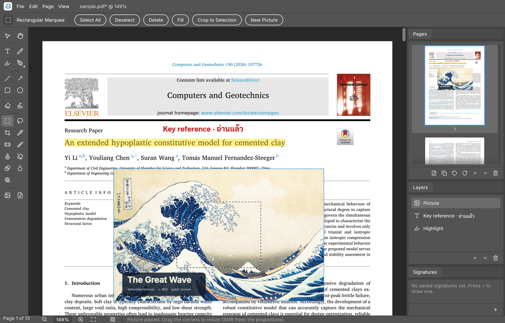
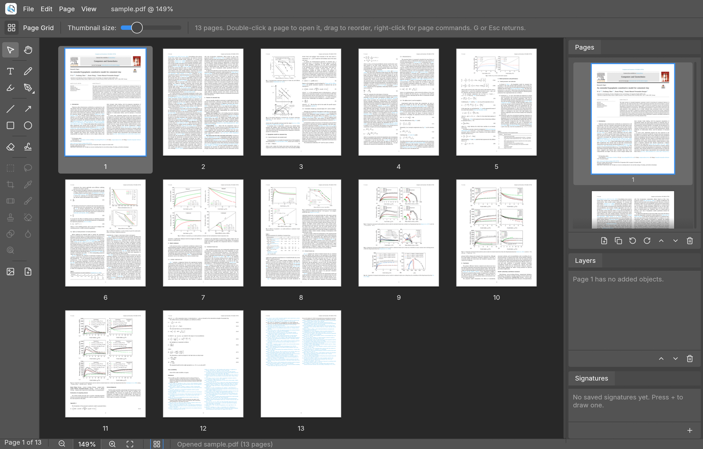

<p align="center">
  <picture>
    <source media="(prefers-color-scheme: dark)" srcset="docs/logo-dark.png">
    
  </picture>
</p>

# PDFflow

PDFflow is a small PDF editor written in Rust that you use the way you use Photoshop. You open a
PDF, place text, pictures, drawings, Bézier paths and signatures on its pages as objects you can
move and resize, retouch pictures with real pixel tools, and save a normal PDF that keeps the
original content intact. The interface is ported from
[PhotoCraft](https://github.com/storytold/photocraft), so it has the same Pro Medium Gray / Pro
Dark palettes, tab-strip panels, panel footers, Spectrum buttons and Lucide icons.



<sub>The title is highlighted, a red note is typed in Thai and English, and a picture is
selected with a marquee selection, so the picture tools in the two-column tool bar are enabled
and the Layers panel lists all three objects. Picture: <i>The Great Wave off Kanagawa</i>,
Katsushika Hokusai, c. 1831, public domain.</sub>

## Features

### Reading and pages

Pages render on a background thread with [hayro](https://github.com/LaurenzV/hayro), a pure-Rust
PDF rasteriser, and only the pages on screen are rendered, so scrolling never blocks the window.
The Pages panel shows thumbnails with buttons to insert a blank page, duplicate, rotate, reorder
and delete, and the same commands are in the Page menu and on a thumbnail's right-click menu.



The **Page Grid** (G, View › Page Grid, or the grid button in the status bar) shows every page at
once. Click selects a page, double-click opens it, dragging reorders pages with an insertion
marker, right-click offers the page commands, and ⌘-scroll or the slider sets the thumbnail size.

### Objects on the page

Everything you add is an object, listed in the Layers panel, that you can select, move, resize
with handles, restack, copy, paste, duplicate and delete, with undo and redo for every step.

| Tool | Key | What it does |
|---|---|---|
| Text | T | Real, selectable text in an embedded Sarabun font, so Thai and Latin both work. It is shaped with the same engine egui uses on screen, so the saved PDF matches what you see. |
| Brush, Highlighter | B, K | Freehand ink; the highlighter multiplies over the page like a marker. |
| Line, Arrow, Rectangle, Ellipse | L, A, R, E | Shapes with stroke colour, width and optional fill (Shift snaps angles or squares the shape). |
| Whiteout | W | Covers existing content with white, so you can type a correction on top. |
| Signature | S | Draw a signature once in the Signatures panel; it is saved and placed with one click. |
| Comment | Z | A sticky note anchored to a point: click a page, type, and it is saved as a real PDF comment (Text annotation) with author, date and colour, so Acrobat, Preview and other readers show it as a comment. The Comments tab lists every comment; comments already in a PDF are loaded for reading and editing. |
| Pictures | drag and drop | Drop PNG, JPEG, GIF, BMP or WebP files from Finder onto a page, or use File › Place Picture. |

### Pen tools

The pen group sits in one tool slot with a corner triangle, as in Photoshop: P selects it,
Shift+P cycles through it, and right-click or press-and-hold opens the flyout. The **Pen** clicks
corner anchors and drags out smooth ones, closes the path when you click the first anchor and
finishes with Enter. The **Freeform Pen** turns a freehand stroke into an editable Bézier path, and
the **Curvature Pen** places points on a smooth curve (Alt-click makes a corner). **Add Anchor
Point** and **Delete Anchor Point** edit a path in place, and **Convert Point** switches an anchor
between corner and smooth or breaks a handle pair. Paths keep their exact curves in the saved PDF.

### Picture tools

When a picture is selected, the picture tools become active, as PhotoCraft does for raster
layers; otherwise they are dimmed and cannot be chosen.

| Tool | Key | What it does |
|---|---|---|
| Rectangular Marquee, Lasso | M, Q | Select pixels; then Delete, Fill, Crop to Selection, or ⌘J for a new picture from the selection. |
| Crop | C | Drag what to keep, Enter applies; the object shrinks so the kept part stays in place. |
| Eyedropper | I | Picks a colour from the picture for the brush and shapes. |
| Spot Healing | J | Blends a blemish into its surroundings. |
| Brush, Eraser | N, X | Paint in colour, or erase to transparency. |
| Clone Stamp | Y | Alt-click sets the source, then paint to copy from it. |
| Gradient | F | Linear gradient from the brush colour to white, inside the selection if there is one. |
| Blur, Dodge/Burn | U, O | Soften, lighten, or darken (hold Alt to burn). |

Size, hardness and opacity are in the options bar, and `[` and `]` change the brush size.

### Digital signatures

PDFflow signs documents with a certificate, not only with a drawn signature. A Digital ID is a
PKCS#12 file (`.p12` / `.pfx`) holding a private key and its certificate: import one issued by a
certificate authority, or create a self-signed one in the Digital IDs tab (RSA-2048, valid for five
years). **File › Sign with Digital ID…** asks for the ID's password, a reason and a location, and
writes a CMS detached signature (`adbe.pkcs7.detached`, SHA-256, RSA or ECDSA P-256) as an
incremental update. The original bytes stay untouched, so signatures already in the file remain
valid and a document can be signed by several people in turn. When a drawn signature (or any
object) is selected, the signature field is placed on it with a "Digitally signed by … / Date"
label; otherwise the signature is invisible and appears only in the signature panel.

When you open a signed PDF, a banner reports whether every signature is valid, and the
**Signature Panel** (View menu) shows for each one whether the signed content is unchanged,
whether the signature matches the signer's certificate, whether later revisions were added, the
signing time and reason, and whether the certificate is self-signed or within its validity period.
Saving an unedited signed file writes it back byte for byte; saving after edits asks first,
because rewriting the content removes the signatures. Signatures made by PDFflow verify as valid
in Poppler's `pdfsig`.

The signature box can show a drawn signature, a saved signature or a picture file, with any of
the signer's name, the date and the reason, laid out as Acrobat does and set in embedded Sarabun
so Thai names display correctly. **Draw Box on Page…** in the sign dialog places it by dragging,
as Acrobat's *Digitally Sign* does. Trusting a root certificate (the ✓ button in Digital IDs, for a
`.crt` / `.cer`) makes signatures whose certificates chain to that root show as verified, with the
chain listed in the signature panel. Each Digital ID shows its expiry date, and an expired ID is
refused with a reminder to renew it.

#### Using a KMUTT Digital ID

KMUTT issues certificate files through `http://mysign.kmutt.ac.th` (see the Computer Center's
*KMUTT Digital Document* manual), and PDFflow uses them the same way Acrobat Reader does:

1. Download `CA.crt` (the *Thai University Consortium Certification Authority* root) and your
   `<login>.p12`, choosing the PKCS#12 password on the site.
2. In PDFflow, open **Digital IDs**, press ✓ and choose `CA.crt` to trust it, then press the folder
   button, choose your `.p12` and enter its password.
3. Open the document, select your drawn signature or use **Draw Box on Page…**, then
   **File › Sign with Digital ID…**, enter the password and **Sign and Save As…** under a new name.
   Others can sign the saved file in turn; every signature stays valid.
4. The `.p12` is valid for about a year. When it expires, download a new one from mysign and
   import it again.

The verification is honest about its limits: it checks integrity and the cryptographic signature,
and the certificate chain up to the roots you trust, but it does not check revocation (CRL or
OCSP), so a certificate revoked after signing still shows as trusted. Signatures carry no trusted timestamp (TSA) or long-term
validation data, and PDF/A or certified (MDP) signatures are not produced.

### Saving

Saving re-reads the untouched source file, rebuilds the page tree in the editor's order and adds
one content stream per edited page, so the original content, links and fonts are kept. Unedited
JPEGs are embedded unchanged, and edited pictures are embedded with their new pixels and alpha.

## Build and run

```sh
cargo build --release
./target/release/pdfflow [file.pdf]
```

## Shortcuts

| Key | Tool | Key | Action |
|---|---|---|---|
| V | Move | ⌘O / ⌘S / ⇧⌘S | Open / Save / Save As |
| H (or hold Space) | Hand | ⌘Z / ⇧⌘Z | Undo / Redo |
| T | Text | ⌘C / ⌘V / ⌘D | Copy / Paste / Duplicate |
| B / K | Brush / Highlighter | ⌫ | Delete the object, or the selected pixels |
| P / ⇧P | Pen tools / next pen tool | Enter, Esc | Finish a path, apply or cancel a crop |
| L / A | Line / Arrow | Arrows (⇧ ×10) | Nudge the selection |
| R / E | Rectangle / Ellipse | ⌘+ / ⌘− | Zoom (also ⌘-scroll and pinch) |
| W / S / Z | Whiteout / Signature / Comment | ⌘0 / ⌘1 | Fit page / 100 % |
| M / Q / C / I | Marquee / Lasso / Crop / Eyedropper | G | Page Grid (Esc returns) |
| J / N / Y / X | Healing / Brush / Clone / Eraser | ⌘J / ⌘A / ⌘D | New picture from selection / select all / deselect |
| F / U / O | Gradient / Blur / Dodge | [ / ] | Brush size |

## Small and light

The release binary is about 12.4 MB (the digital-signature crypto adds about 1.5 MB), and with a 13-page journal paper open at 150 % on a Retina
display the app uses about 95 MB of memory. It runs egui on the glow (OpenGL) renderer with no web
view and repaints only on input. Page textures are capped at 4096 px per side and 12 MP and are
kept only for visible pages, and placed pictures keep a preview of at most 1024 px on screen while
their original bytes go into the PDF. Edited pictures are stored in copy-on-write 128 px tiles, so
an undo step stores only the tiles a stroke touched, and pictures larger than 2048 px are resampled
when editing starts. The icons are Lucide SVGs flattened to polylines at build time
(`tools/icons_to_rust.py`), so no SVG renderer is linked.

## Limits

- Existing PDF text is not edited in place; cover it with Whiteout and type over it.
- Encrypted (password-protected) PDFs cannot be opened.
- Text is set without automatic line wrapping (press Return for a new line).
- Pictures larger than 2048 px are resampled to 2048 px when you first edit their pixels.
- Signature verification trusts only the roots you import and does not check revocation.

## Tests

`cargo test` runs 37 tests. Round-trip tests save a document, render the saved file again with
hayro and check pixels for every page rotation and crop box, embedded text, pictures, ink, filled
paths, edited pixels and page reordering. Interaction tests drive the real window headlessly with
egui_kittest: drawing, typing Thai, moving, resizing, undo, signatures, the Page Grid, every pen
tool, the picture tools (selection, delete, brush, crop, eyedropper and ⌘J), and digital signatures
(sign, tamper detection, countersigning on both cross-reference formats, wrong passwords, the
save guard, the visible signature box landing on the selected object or a dragged box, a simulated
university CA chain with a Thai-named certificate, and the drawn appearance), and comments (placed,
typed in Thai, saved as Text annotations at the right place, read back, and replaced rather than
duplicated on the next save).

## Licences

Code: MIT OR Apache-2.0. The PDFflow logo and app icon are in `docs/logo.png`, `docs/logo-dark.png` and
`assets/icon.png`. Theme tokens, widgets and the pen and picture tool icons are adapted from
PhotoCraft (MIT OR Apache-2.0). Icons: Lucide (ISC). Fonts: Inter and Sarabun (SIL OFL 1.1, see
`assets/fonts`).
